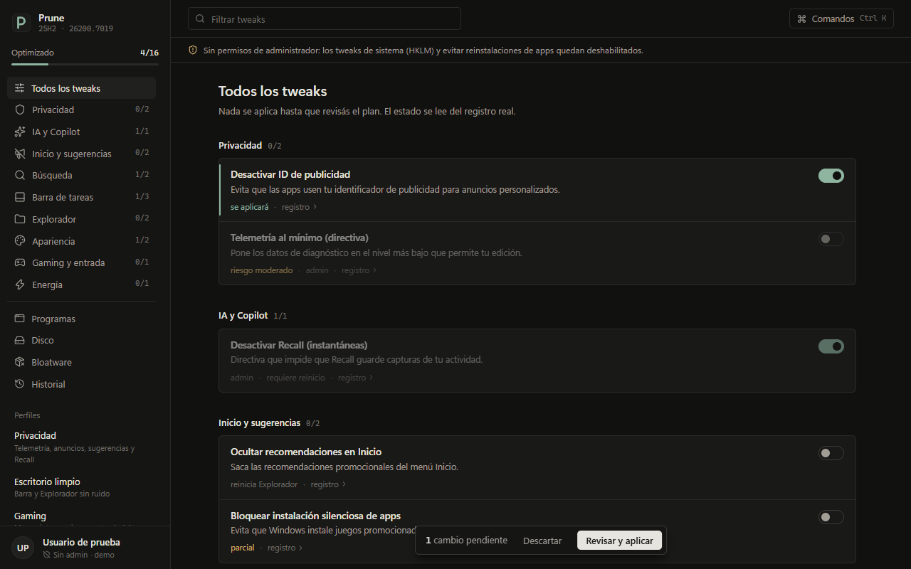
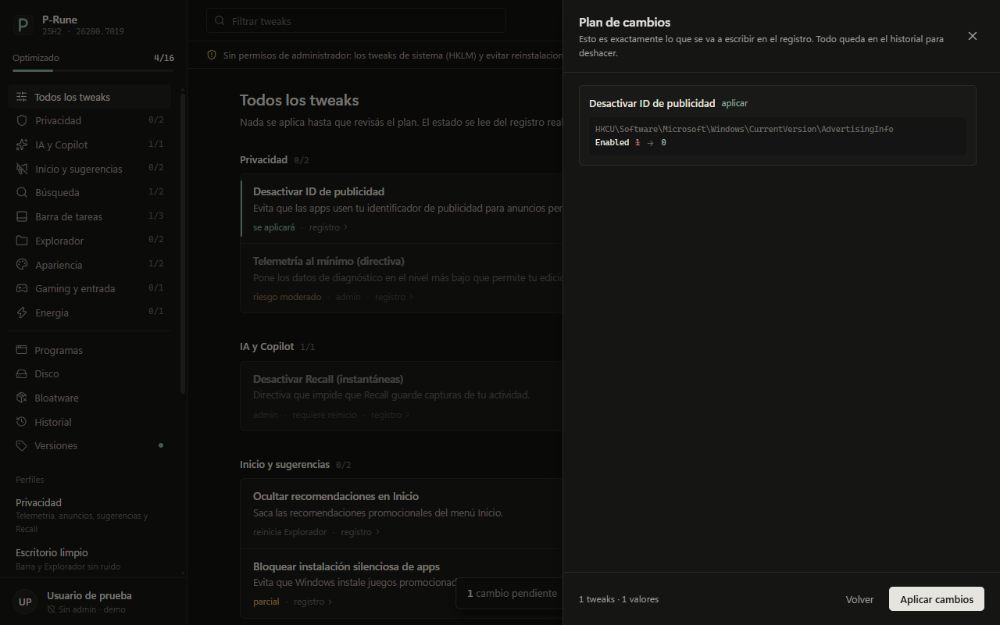
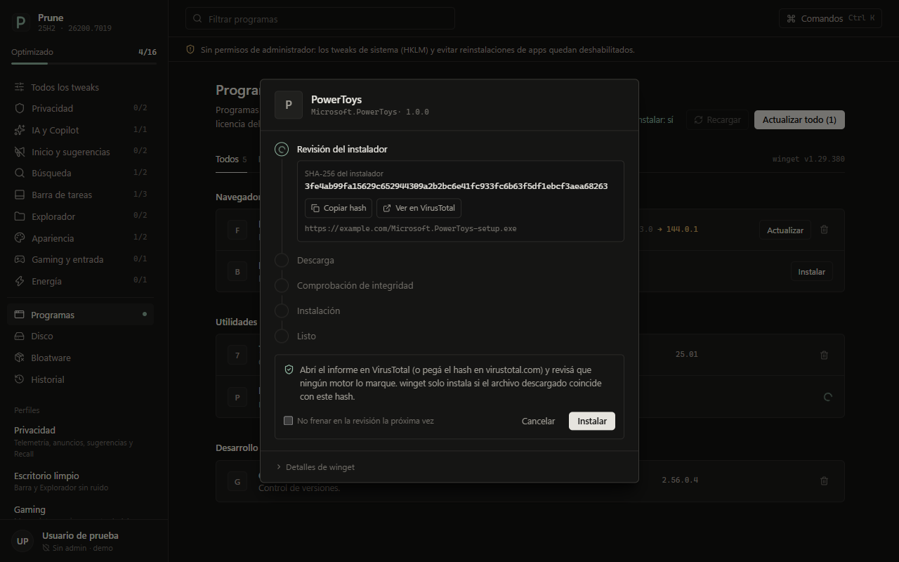
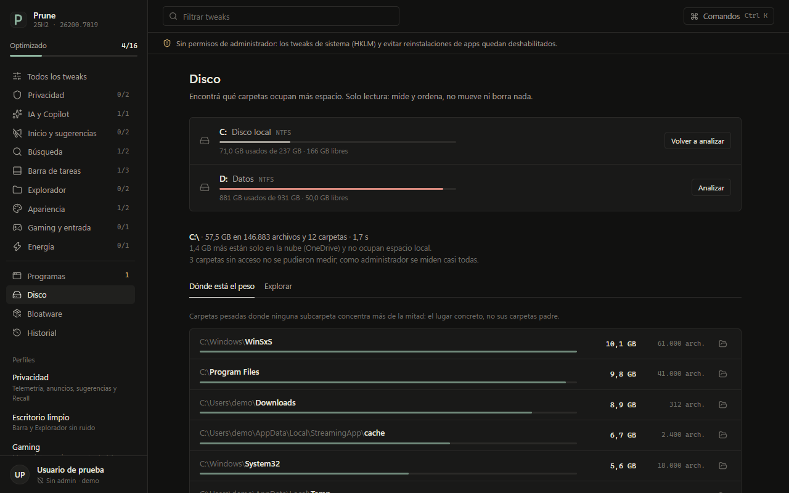
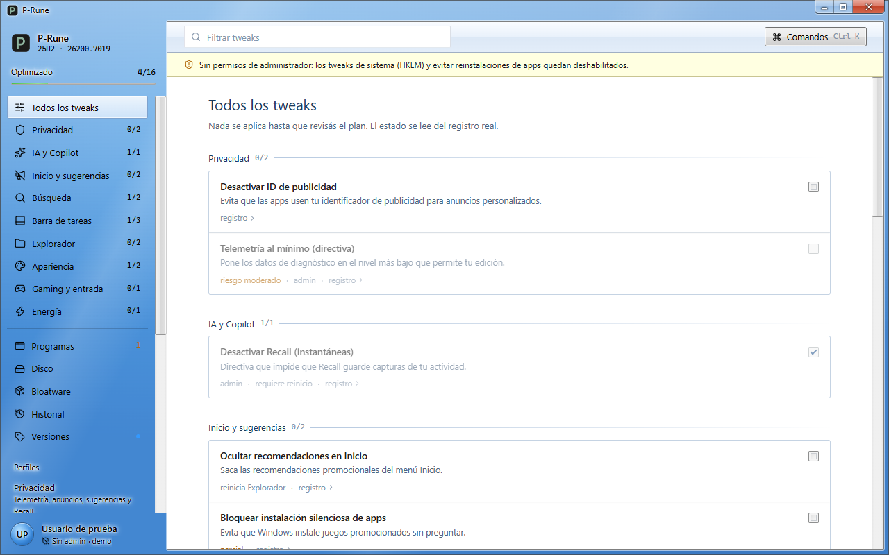

<p align="center">
  
</p>

<h1 align="center">P-Rune</h1>

<p align="center">
  Debloater y ajustes para <b>Windows 11</b>, con vista previa de cada cambio y deshacer exacto.<br />
  Hecho con Tauri 2 (Rust) + Svelte 5 + Tailwind 4. En 9 idiomas.
</p>



> [!WARNING]
> P-Rune modifica el registro de Windows, quita apps preinstaladas e instala programas, y corre como
> administrador. Revisá el plan antes de aplicar cada cambio. Se distribuye **sin garantía** (ver
> [LICENSE](LICENSE)): usalo bajo tu responsabilidad. Quitar apps no se puede deshacer desde P-Rune;
> se reinstalan desde Microsoft Store.

## Qué hace

- **Tweaks** de privacidad, IA/Copilot, Inicio, búsqueda, barra de tareas, Explorador, apariencia,
  gaming y plan de energía. Cada switch muestra el estado **real** del registro.
- **Plan antes de aplicar**: el diff exacto de cada valor que se va a escribir.
- **Historial con deshacer**: guarda el valor anterior exacto; si algo cambió después, avisa antes de pisarlo.
- **Perfiles** (Privacidad, Escritorio limpio, Gaming, Equipo liviano) que marcan varios tweaks de una.
- **Bloatware**: quita apps Appx de una lista curada; lo esencial (Store, winget, Terminal,
  Calculadora, Seguridad de Windows) nunca aparece.
- **Programas**: instala y actualiza ~40 programas confiables con winget, con progreso por etapas y una
  revisión previa con el **SHA-256 del instalador** para verificarlo en VirusTotal.
- **Disco**: encuentra las carpetas que más ocupan (solo lectura: no mueve ni borra nada).
- **Temas**: Moderno (oscuro) y Aero 7, con **transparencia real** opcional (acrílico de Windows).
- **Idiomas**: español, English, Português (Brasil), Français, Deutsch, Italiano, 简体中文, 日本語 y
  Русский. Usa el idioma de Windows la primera vez y se cambia en vivo desde la barra lateral o con Ctrl K.
  Se traduce todo: interfaz, catálogo de tweaks, bloatware, programas y mensajes de error.
- **Bienvenida**: al abrir, una pantalla breve con la foto y el usuario de Windows de quien la abrió.

| Plan de cambios | Revisión antes de instalar |
|---|---|
|  |  |

| Disco | Tema Aero 7 |
|---|---|
|  |  |

## Instalación

Descargá el instalador **`.msi`** desde *Releases* (también hay uno `.exe` hecho con NSIS). Se instala
para todo el equipo en `Program Files\P-Rune` y pide permisos de administrador al abrirse.

Si tenías la 0.1.0 (se llamaba Prune), el instalador nuevo la reemplaza y P-Rune trae su historial al
abrirse por primera vez.

Los ejecutables todavía no están firmados: Windows SmartScreen puede mostrar "editor desconocido".

## Seguridad

- **Sin PowerShell ni consola**: el registro se toca con `winreg`, las apps con la API WinRT
  `PackageManager` y la energía con `powrprof`.
- **Superficie mínima**: los comandos solo aceptan IDs del catálogo; la interfaz tiene solo los permisos
  que usa, CSP estricta y prototipos congelados.
- **winget verificado**: se ejecuta desde `Program Files\WindowsApps` y solo si la firma es de Microsoft.
- **Historial protegido**: instalada, guarda el historial en `Program Files\P-Rune\data` (solo admins
  escriben) y valida cada entrada contra el catálogo antes de deshacer.
- DLLs solo desde `System32` y carpetas temporales con permisos solo para administradores.

Para reportar una vulnerabilidad, ver [SECURITY.md](SECURITY.md).

## Desarrollo

```bash
npm install
npm run tauri dev      # app real (sin admin en debug: los tweaks de sistema quedan deshabilitados)
npm run dev            # solo la interfaz en el navegador, con datos simulados (no toca el sistema)
cd src-tauri && cargo test
npm run tauri build    # instaladores MSI y NSIS; el exe de release pide administrador (UAC)
npm run check:locales  # verifica que las traducciones de la interfaz usen los mismos {valores}
```

## Estructura

| Ruta | Qué hay |
|---|---|
| `src-tauri/catalog/tweaks.toml` | Tweaks: categoría, riesgo, build mínima, operaciones, opciones |
| `src-tauri/catalog/bloat.toml` | Apps removibles por nivel (seguro / moderado / avanzado) |
| `src-tauri/catalog/apps.toml` | Programas de winget por grupo, con su sitio oficial |
| `src-tauri/src/engine.rs` | Estado, plan, aplicar todo-o-nada, historial y deshacer |
| `src-tauri/src/registry.rs` | Lectura y escritura del registro (vista 64 bits) |
| `src-tauri/src/appx.rs` | Listar y quitar paquetes del catálogo |
| `src-tauri/src/winget.rs` | winget: estado, instalar/actualizar/desinstalar, progreso |
| `src-tauri/src/disk.rs` | Análisis de uso de disco en paralelo |
| `src-tauri/src/power.rs` | Plan de energía |
| `src-tauri/src/i18n.rs` | Idioma del backend: mensajes y textos del catálogo |
| `src-tauri/locales/` | Traducciones del catálogo y de los mensajes (el español vive en los `.toml`) |
| `src/lib/locales/` | Traducciones de la interfaz (`es.ts` define las claves) |
| `src/lib/` | Estado de la interfaz, temas, componentes |

## Origen

P-Rune nació como reescritura de [`debloater-alpha`](https://github.com/buccellaluciano/debloater-alpha):
de ahí se tomaron solo los datos (claves de registro y lista de bloatware), revisados y corregidos.

## Licencia

[MIT](LICENSE) © 2026 buccellaluciano
